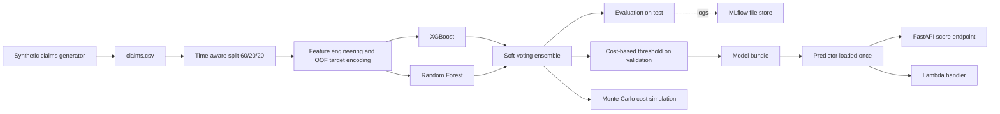

# insurance-fraud-detection

[](https://github.com/Beru47/insurance-fraud-detection/actions/workflows/ci.yml)

An end-to-end fraud detection pipeline for insurance claims: a seeded synthetic claims generator, an XGBoost + Random Forest soft-voting ensemble, a **cost-based decision threshold**, a **Monte Carlo** model of annual claim cost and fraud savings, MLflow tracking, and a FastAPI / AWS Lambda-style scoring service that share one predictor.

> **Scope note.** This is a personal reference project that mirrors the kind of work I have done on fraud ensembles and Monte Carlo cost modeling. It runs on **synthetic data only**. Every number below was computed by this code on that synthetic data. None of it describes a production system or real-world results, and the absolute values say nothing about real claims.

## Architecture



## Problem framing

Each claim is scored for fraud likelihood; flagged claims go to a special investigations unit (SIU). Flagging is not free, and missing fraud is not free either, so the model is judged by money, not only by ranking quality.

The generator injects probabilistic fraud patterns (so classes overlap) at about a 4% rate: young policies, inflated and round-number amounts, very quick or very late reports, repeat claimants, a ring of 10 garages and 6 providers, and soft-tissue-type injuries. Features also include policy age, delay to report, prior claims, claimant age and garage/provider ids (encoded as smoothed fraud rates, computed out-of-fold on train to avoid target leakage).

The split is **chronological** (train on the oldest 60%, choose the threshold on the next 20%, report on the latest 20%), as a production model would always score future claims.

## Why PR-AUC and not accuracy

With about 4% positives, predicting "never fraud" is 96% accurate and useless. ROC-AUC is also flattering when negatives dominate. Precision-recall AUC (average precision) only looks at how well the fraud class is ranked and how many false alarms it costs, which is what an investigations team feels. I also report recall at fixed precision (50% and 80%), i.e. how much fraud is caught if the SIU only tolerates a given hit rate.

Imbalance handling: `scale_pos_weight` (square root of the class ratio) for XGBoost and `balanced_subsample` class weights for the forest.

## The cost-based threshold

The threshold is not 0.5. It maximises expected net savings on the validation split:

```
net savings = sum(amount of flagged fraudulent claims) - investigation_cost * (number flagged)
```

with a 200 per-investigation cost (an assumption, see `costs.py`). Because a missed fraud costs its full claim amount while a false alarm costs only an investigation, the optimum sits at a low score and accepts many false positives: **high recall, low precision** is the right operating point here, and it changes if the cost ratio changes.

## Monte Carlo cost model

`montecarlo.py` simulates one year (50,000 claims, 300 runs) by bootstrapping the held-out claims and drawing uncertain inputs per run: investigation cost (lognormal), claim severity inflation (lognormal) and the share of investigated frauds that are actually denied (Beta, mean 0.9). It reports expected annual claim cost and savings, with 5th-95th percentile bands, across thresholds.

## Results (synthetic data, seed 42, 50,000 claims, chronological test set of 10,000 claims at 3.93% fraud)

Reproduce with `make train`. Metrics are on the held-out test set.

| Model | PR-AUC | Recall @ precision 50% | Recall @ precision 80% |
|---|---|---|---|
| XGBoost | 0.836 | 0.868 | 0.725 |
| Random Forest | 0.799 | 0.855 | 0.684 |
| Soft-voting ensemble | 0.824 | 0.858 | 0.746 |

On this run the ensemble does not beat XGBoost alone on PR-AUC; it is kept because it is steadier at high precision and for the exercise of combining models.

**At the cost-chosen threshold (0.112 on the ensemble score):**

| | |
|---|---|
| Confusion matrix (TN / FP / FN / TP) | 8658 / 949 / 27 / 366 |
| Precision / recall | 27.8% / 93.1% |
| Net savings on test set | 2.91M vs 3.36M fraud loss with no model |

**False-positive analysis:** 72% of flags are false alarms (a 9.9% false-positive rate on legitimate claims). They skew toward whiplash (25%), no-injury (20%) and soft-tissue (20%) claims, which mirror the injected fraud patterns, and have a higher mean amount (9.2k) than true positives (8.7k). 12% sit in the fraud-ring garages.

**Top permutation importance (drop in ensemble PR-AUC):** `round_amount` 0.203, `prior_claims` 0.079, `garage_id_rate` 0.076, `injury_none` 0.069, `report_delay_days` 0.063.

**Monte Carlo, annual scale (50,000 claims; baseline cost with no fraud screening about 269.5M):**

| Threshold | Expected annual cost | Expected savings (mean) | 5th - 95th pct |
|---|---|---|---|
| 0.05 | 256.6M | 12.92M | 9.67M - 16.04M |
| 0.112 (validation-chosen) | 256.3M | 13.19M | - |
| 0.15 (best on MC grid) | 256.3M | 13.22M | 10.20M - 16.17M |
| 0.30 | 257.0M | 12.58M | 9.58M - 15.24M |
| 0.50 | 257.5M | 12.06M | 9.32M - 14.65M |
| 0.90 | 262.8M | 6.71M | 5.14M - 8.08M |

The savings curve is flat around 0.1-0.2, so the validation-chosen threshold is within noise of the Monte Carlo optimum. The uncertainty band is wider than the gap between thresholds in that region.

Caveat: the generator is mine, so patterns are easy to learn compared with real claims and the numbers are optimistic by construction. The point is the pipeline and the decision framework.

## Run it

```bash
pip install -e ".[dev]"
make data        # generate data/claims.csv (50k claims, seed 42)
make train       # fit, evaluate, log to MLflow (./mlruns), write models/ and reports/
make evaluate    # re-evaluate the saved model, incl. Monte Carlo
make serve       # FastAPI on :8000
make test
make lint
```

Score a claim:

```bash
curl -s localhost:8000/score -H "content-type: application/json" -d '{
  "claim_amount": 9000, "policy_age_days": 12, "report_delay_days": 0.5, "prior_claims": 3,
  "claimant_age": 35, "garage_id": "G0002", "provider_id": "P001", "injury_type": "whiplash"}'
```

Lambda: point the handler at `fraudlab.serve.handler`. It accepts a claim dict or an API Gateway event with a JSON `body`, and returns `{statusCode, body}`. The model bundle is loaded once per process (path from the `MODEL_PATH` env var, default `models/bundle.joblib`), so warm invocations and API requests reuse it. The bundle is a joblib file produced by `make train`; only load bundles you created.

Browse MLflow runs with `mlflow ui --backend-store-uri ./mlruns` (set `MLFLOW_ALLOW_FILE_STORE=true` on recent MLflow versions).

## Structure

```
src/fraudlab/
  data.py         seeded synthetic claims generator
  features.py     feature engineering, out-of-fold target encoding
  model.py        chronological split, XGBoost + RF, soft-voting ensemble
  costs.py        net-savings function and cost-based threshold
  evaluate.py     PR-AUC, recall@precision, confusion matrix, FP analysis, permutation importance
  montecarlo.py   annual cost / savings simulation
  serve.py        shared Predictor, FastAPI app, Lambda handler
  cli.py          data / train / evaluate commands
tests/            determinism, features, threshold logic, Monte Carlo, API and handler
.github/workflows/ci.yml   ruff + pytest + small training smoke run
```

CI runs lint, the tests and a training smoke run on 6,000 synthetic claims. Data, models, reports and MLflow runs are gitignored.

## Roadmap

- Probability calibration (isotonic) and a real stacked meta-learner.
- Per-claim-type investigation costs and SIU capacity constraints in the threshold.
- Drift monitoring and scheduled retraining; a feedback loop from investigation outcomes.
- SHAP explanations per flagged claim.
- Packaging for Lambda (container image) with an example deployment template.
